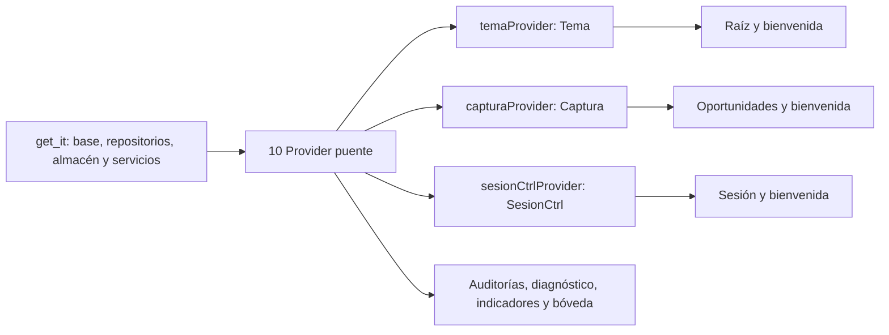

# Informe técnico de la Semana 12 sobre gestión de estado con Riverpod en ManosSeguras

**BORRADOR — C1–C4 guardadas; inserción, roles y códigos pendientes de confirmar.** Este archivo es editable. La edición institucional en DOCX y el PDF se prepararán después de revisar, censurar e insertar las capturas. La extensión de 18 a 28 páginas sin anexos deberá comprobarse en esa edición paginada.

Universidad Andina del Cusco · Facultad de Ingeniería y Arquitectura · Escuela Profesional de Ingeniería de Sistemas  
SIS048 · Desarrollo de Software II · Unidad II · Semana 12 · Guía de Aplicación 08, Parte I  
Semestre académico 2026-II · Ciclo VII · Cusco, Perú · 17 de octubre de 2026

## 1. Datos del equipo y del proyecto

**Tabla 1.** *Ficha del proyecto*

| Campo | Valor |
|---|---|
| Asignatura | SIS048 — Desarrollo de Software II |
| Docente | Mtro. Ing. Yover Collantes Valer, según la plantilla suministrada |
| Semestre académico | 2026-II · Ciclo VII |
| Unidad / Semana | Unidad II · Semana 12 · Guía de Aplicación 08 · Parte I |
| Título del proyecto | ManosSeguras: gestión de estado avanzada con Riverpod |
| Repositorio (URL y visibilidad) | **Pendiente de proporcionar.** La carpeta recibida no contiene `.git`. |
| Entorno de esta verificación | Windows NT 10.0.26200.0 · Flutter 3.47.1 · Dart 3.13.1 |
| Estado del informe | Borrador con pruebas automáticas verificadas y C1–C4 guardadas; falta la edición institucional |

*Nota.* Las versiones proceden de `docs/evidencias_semana12/00_entorno.txt`. No se atribuyen a los equipos de otros integrantes.

**Tabla 2.** *Integrantes y roles Scrum*

| Apellidos y nombres | Código | Rol propuesto | Responsabilidad propuesta, no actividad acreditada |
|---|---|---|---|
| CARDENAS CARRASCO LEONARDO | Pendiente | Scrum Master y documentación | Coordinar pendientes, informe y sustentación. |
| QUISPE DAVIDA JOSE JOSE | Pendiente | Responsable técnico | Trabajar providers, integración con `get_it` y generación de código. |
| VITORINO DURAN DAVIS SHUMAGER | Pendiente | Responsable de calidad | Verificar pruebas, análisis estático y evidencias de seguridad. |
| YABAR LATORRE GONZALO YABAR | Pendiente | Product Owner y validación funcional | Validar captura, borrador, guardado y sesión. |

Los roles y responsabilidades son la **propuesta proporcionada para confirmación por el equipo**; no acreditan tareas ya realizadas por cada integrante. Todos los códigos universitarios siguen pendientes. El archivo de origen ya estaba identificado como Semana 12; no se recibió un repositorio de la Semana 11 ni un historial de commits para demostrar qué cambios hizo cada persona.

## 2. Resumen ejecutivo

El proyecto recibido ya contenía tres `Notifier` para tema, captura y sesión, con ocho providers puente que publicaban dependencias construidas por `get_it`. Esta revisión añadió dos puentes, eliminó llamadas directas a `getIt` de las pantallas y cerró riesgos de duplicación de auditorías y exposición de datos en la traza y la bóveda. El borrador sobrevive a la navegación; la sesión conserva el almacén seguro, el descarte de tokens vencidos y una interfaz que muestra solo la huella. Las pantallas secundarias incorporan regreso explícito a bienvenida o a su pantalla matriz sin descartar el borrador. La batería pasó de 135 pruebas aprobadas en el ZIP recibido a 140 en la versión revisada, con una omitida en ambos casos. La cifra anterior a la Semana 12 no puede reconstruirse sin esa versión. C1–C4 están guardadas, pero falta su revisión editorial e inserción; también quedan pendientes los códigos, la confirmación de roles y la comparación histórica. `AsyncNotifier` y `AsyncValue` corresponden a la Semana 13.

## 3. Decisión de arquitectura: por qué Riverpod

### 3.1. El problema, con datos del propio código

El flujo de captura usa una lista de oportunidades, una acción seleccionada, un correlativo, un indicador de guardado y la preferencia del último establecimiento. Los comentarios del código recibido describen **seis campos** y **cinco llamadas** a `setState` en la versión anterior. No se dispone del archivo de esa versión; por ello esas cifras son una descripción heredada, **no una medición independiente**. Sí se comprobó que la pantalla actual `pantalla_oportunidades.dart` no contiene ninguna llamada ejecutable a `setState` y que sus reglas de negocio viven en `Captura`.

Con estado limitado al `State` de la ruta, la bienvenida no podría leer directamente el borrador en curso. En el código actual ambas pantallas observan `capturaProvider`; la sesión y el tema siguen el mismo patrón. La prueba `es keepAlive: sin oyentes el borrador sigue ahí` comprueba la conservación del borrador dentro del contenedor después de cancelar una suscripción. C1 y C2 ya están guardadas como evidencia visual del recorrido, aunque siguen sin insertarse en la edición paginada. La distinción entre estado local y estado compartido se apoya en la guía oficial de Flutter (Google, s. f.) y en la recomendación de Riverpod de dejar los controladores dentro de los widgets (Rousselet, 2026b).

La lógica de correlativo y guardado puede probarse sin montar la interfaz mediante `ProviderContainer.test()` y sustituciones de los repositorios. Las pruebas de widget siguen siendo necesarias para confirmar que la pantalla reacciona y que nunca publica el token. Este reparto coincide con el método de pruebas documentado por Riverpod (Rousselet, 2026e). No se dispone de una suite anterior a la Semana 12 con la cual medir cuánto costaba probar las mismas reglas.

### 3.2. Alternativas evaluadas

**Tabla 3.** *Alternativas para el estado compartido*

| Alternativa | Ventaja | Inconveniente en este proyecto | ¿Se eligió? |
|---|---|---|---|
| `StatefulWidget` y `setState` | Directo para formularios, carga de una ruta y controladores locales. | El borrador y la sesión necesitan observarse desde más de una ruta; compartirlos exigiría elevar el estado o construir un mecanismo propio. | Sí, solo para estado efímero de pantallas no migradas. |
| `package:provider` | Integración conocida con el árbol de Flutter. | La ubicación del provider en el árbol entra en las pruebas y los cambios de rutas; Riverpod documenta diferencias de alcance y de errores por provider no encontrado (Rousselet, 2026c). | No. |
| `get_it` con `ValueNotifier` | Reutiliza el contenedor de la Semana 9 y conserva una API simple. | Exige gestionar manualmente la suscripción de cada pantalla y deja el estado de negocio en objetos construidos fuera del contenedor reactivo. | No para el estado; `get_it` sigue construyendo dependencias. |
| Riverpod con `Notifier` y providers puente | Estado compartido, ciclo de vida explícito y overrides para pruebas sin UI. | Requiere archivos generados, `ProviderContainer` y una frontera clara entre estado de negocio y estado efímero. | Sí. |

*Nota.* La comparación describe el efecto de cada opción sobre este código; no atribuye ventajas de rendimiento sin medición. La motivación oficial de Riverpod compara sus modelos de alcance y pruebas con `provider` (Rousselet, 2026c).

### 3.3. Decisión y consecuencias

Se conservó `get_it` como composición de objetos. Los diez providers simples solo obtienen instancias de ese grafo; no crean una segunda base de datos ni un segundo repositorio. Los tres `Notifier` gestionan los valores que cambian y las pantallas los leen con `ref.watch` o ejecutan acciones con `ref.read`. La documentación de Riverpod define `NotifierProvider` como la variante mutable y permite sustituir providers en pruebas (Rousselet, 2026d; Rousselet, 2026e).

La ganancia demostrada en esta entrega es la prueba aislada de correlativos, borrador, sesión y seguridad, junto con la lectura compartida del borrador y la sesión desde bienvenida. El costo aceptado es mantener `build_runner`, los tres `.g.dart` y el contenedor en el arranque. La generación usa `@Riverpod(keepAlive: true)` para los tres estados persistentes durante la vida de la aplicación. En providers generados, `autoDispose` es el valor por defecto; `keepAlive` evita destruir el borrador cuando la ruta deja de escucharlo (Rousselet, 2026a). Este argumento es funcional; no implica que el borrador se guarde en disco entre cierres de la aplicación.

## 4. Diseño de la capa de estado

### 4.1. Diagrama del grafo de estado

**Figura 1.** *Grafo de construcción, publicación y observación del estado*



*Nota.* Elaboración a partir de `presentation/di.dart`, `dependencias_providers.dart`, los tres `Notifier` y las pantallas revisadas el 17 de octubre de 2026. La figura es un esquema de código, no una medición de dependencias en ejecución.

`main()` configura `get_it` antes de crear el `ProviderContainer`; luego carga el tema y restaura la sesión antes del primer fotograma y finalmente entrega el contenedor a `UncontrolledProviderScope`. Esto conserva la secuencia de arranque de las semanas anteriores. Los providers puente cachean la referencia que obtienen de `get_it`, mientras los `Notifier` conservan las reglas de cambio. El acceso directo a `getIt` se retiró de los archivos de pantallas: `rg -n 'getIt<' lib/presentation/pantallas` no devolvió coincidencias después de la revisión.

[INSERTAR EVIDENCIA C1: usar `docs/evidencias_semana12/capturas/C1_bienvenida_borrador.png`; muestra tres oportunidades en la tarjeta «Estado compartido por Riverpod».]

### 4.2. Inventario de providers

**Tabla 4.** *Providers publicados y ámbito*

| Provider | Tipo | Estado o valor que expone | Ámbito | Justificación del ámbito | Quién lo observa o lee |
|---|---|---|---|---|---|
| `auditoriaRepositoryProvider` | `Provider` simple | `AuditoriaRepository` | Contenedor | Publica el singleton ya construido. | Captura, listado y detalle. |
| `indicadorRepositoryProvider` | `Provider` simple | `IndicadorRepository` | Contenedor | Reutiliza la caché y el repositorio offline first. | Diagnóstico e indicadores. |
| `preferenciasRepositoryProvider` | `Provider` simple | `PreferenciasRepository` | Contenedor | Una referencia al repositorio de preferencias. | Tema, captura y diagnóstico. |
| `sesionRepositoryProvider` | `Provider` simple | `SesionRepository` | Contenedor | Mantiene una implementación única del almacén de sesión. | Sesión y bóveda. |
| `almacenSeguroProvider` | `Provider` simple | `AlmacenSeguro` | Contenedor | Publica el adaptador configurado en `get_it`. | Bóveda. |
| `generadorTokenProvider` | `Provider` simple | `GeneradorTokenSimulado` | Contenedor | Servicio inyectable y sustituible en pruebas. | Sesión. |
| `directorioUsuariosProvider` | `Provider` simple | `DirectorioUsuariosSimulado` | Contenedor | Servicio inyectable y sustituible en pruebas. | Sesión y formulario. |
| `preferenciasDaoProvider` | `Provider` simple | `PreferenciasDao` | Contenedor | La bóveda reutiliza el DAO de `get_it`. | Bóveda. |
| `manosSegurasDbProvider` | `Provider` simple | `ManosSegurasDb` | Contenedor | Evita abrir otra conexión SQLite. | Diagnóstico. |
| `sembradorDatosProvider` | `Provider` simple | `SembradorDatos` | Contenedor | Publica el servicio ya compuesto. | Diagnóstico. |
| `temaProvider` | `Notifier` generado | `ThemeMode` | `keepAlive` | La preferencia es de aplicación y se consulta desde la raíz. | Raíz y bienvenida. |
| `capturaProvider` | `Notifier` generado | `EstadoCaptura` | `keepAlive` | El borrador debe sobrevivir a la navegación. | Captura y bienvenida. |
| `sesionCtrlProvider` | `Notifier` generado | `EstadoSesion` | `keepAlive` | La sesión se comparte entre rutas. | Sesión y bienvenida. |

*Nota.* Los diez providers simples están escritos a mano; los tres `NotifierProvider` son generados. No hay `AsyncNotifier` ni `AsyncValue` en la capa nueva de Semana 12.

### 4.3. Matriz de decisiones de estado

**Tabla 5.** *Frontera entre estado compartido y estado del widget*

| Estado | ¿Compartido? | ¿Sobrevive a la navegación? | ¿Tiene reglas comprobables? | Destino | Ámbito | Justificación |
|---|---|---|---|---|---|---|
| Tema | Sí | Sí | Sí, persistencia y alternancia | `Tema` | `keepAlive` | Es una preferencia global; la raíz la observa. |
| Borrador de oportunidades y acción seleccionada | Sí | Sí | Sí, correlativo, eliminación, guardado y fallo | `Captura` | `keepAlive` | Bienvenida y captura muestran el mismo trabajo en curso. |
| Sesión, progreso y último fallo | Sí | Sí | Sí, reentrada, expiración y cierre | `SesionCtrl` | `keepAlive` | Varias rutas necesitan el estado vigente. |
| Último establecimiento | Sí | Sí dentro de la aplicación; además hay preferencia en SQLite | Sí, recuperación tras guardado | `Captura` | `keepAlive` | Se muestra en bienvenida y captura; el código de preferencia ya existía. |
| Controladores de documento y clave | No | No | Validación local del formulario | `State` de sesión | Vida de la ruta | `TextEditingController` es estado efímero; se elimina al desmontar. |
| `GlobalKey<FormState>` | No | No | Validación local | `State` de sesión | Vida de la ruta | Pertenece al formulario, no al negocio compartido. |
| `Future` de detalle, diagnóstico e indicadores | No | No | Carga por ruta; migración asíncrona futura | `State` + `FutureBuilder` | Vida de la ruta | No se adelanta `AsyncNotifier` de Semana 13. |
| Indicador de recarga y experimento de bóveda | No | No | Operación de UI local | `State` de cada pantalla | Vida de la ruta | No se consulta desde otras rutas. |

*Nota.* La matriz adapta el §15 de la guía suministrada. Flutter y Riverpod distinguen estado de aplicación y estado efímero con un criterio funcional, no por el tipo de variable (Google, s. f.; Rousselet, 2026b).

## 5. Providers simples y generación de código

### 5.1. El puente de dependencias

El puente no construye objetos. Por ejemplo, el repositorio de auditorías se publica así:

```dart
final Provider<AuditoriaRepository> auditoriaRepositoryProvider =
    Provider<AuditoriaRepository>(
  (Ref ref) => getIt<AuditoriaRepository>(),
  name: 'auditoriaRepository',
);
```

La revisión añadió `manosSegurasDbProvider` y `sembradorDatosProvider`, y cambió las pantallas que todavía leían `getIt` para que consuman estos puentes. Los `FutureBuilder` y `StreamBuilder` de las rutas anteriores conservaron su funcionamiento. El criterio de la plantilla queda comprobado mediante la siguiente consulta de texto:

```text
> rg -n 'getIt<' lib/presentation/pantallas
Sin coincidencias (código de salida 1 de rg).
```

### 5.2. Configuración de la generación de código

**Tabla 6.** *Dependencias resueltas en este entorno*

| Paquete | Versión resuelta | Fuente de comprobación |
|---|---|---|
| `flutter_riverpod` / `riverpod` | 3.4.3 / 3.4.3 | `flutter pub deps --style=compact` |
| `riverpod_annotation` | 4.0.7 | Mismo comando |
| `riverpod_generator` | 4.0.9 | Mismo comando |
| `build_runner` | 2.15.1 | Mismo comando |
| `drift` / `drift_dev` | 2.34.4 / 2.35.1 | Mismo comando |
| `flutter_secure_storage` | 11.2.0 | Mismo comando |
| `riverpod_lint` | No declarado | `pubspec.yaml` y resolución actual |

La ejecución final de `dart run build_runner build` terminó con `Built with build_runner/aot in 8s; wrote 90 outputs.` Esa cifra es del trabajo informado por `build_runner` en una ejecución incremental; **no** significa que se hayan modificado 90 archivos versionados. La ejecución inicial, sobre el ZIP recibido, informó 156 outputs. La salida íntegra se conserva en `12_build_runner_final.txt` y `02_build_runner.txt`.

```text
> flutter pub deps --style=compact | [filtrado por paquetes relevantes]
flutter_riverpod 3.4.3
riverpod_annotation 4.0.7
riverpod_generator 4.0.9
riverpod 3.4.3
build_runner 2.15.1
```

La tabla reproduce los números resueltos por el comando; la salida literal completa está en `docs/evidencias_semana12/05_flutter_pub_deps.txt`. No se deduce la versión desde un rango de `pubspec.yaml`.

### 5.3. Decisión sobre el código generado

**Tabla 7.** *Decisión sobre los archivos `.g.dart`*

| Elemento | Desarrollo del equipo |
|---|---|
| Archivos que se conservan | `tema_provider.g.dart`, `captura_provider.g.dart` y `sesion_provider.g.dart`. |
| Regla de `.gitignore` | `!lib/presentation/providers/*.g.dart` permite incluirlos. |
| Motivo | Sin ellos, los `part` de cada provider quedarían sin destino y el análisis fallaría con `Target of URI doesn't exist`. |
| Argumento contrario | Omitir generados reduce diffs, pero obliga a cada clon a ejecutar el generador antes de analizar o compilar. |
| Estado verificable aquí | Los tres archivos existen y `build_runner` concluyó. `captura_provider.g.dart` cambió respecto del ZIP inicial; los otros dos y el archivo generado de drift conservaron su SHA-256. |
| Límite | La carpeta no contiene `.git`: aún no puede afirmarse que esos archivos estén en un commit remoto. |

*Nota.* La generación de código y `keepAlive` se documentan en la fuente oficial de Riverpod (Rousselet, 2026a). El manifiesto de hashes inicial permite revisar qué archivos cambiaron en esta sesión.

## 6. Migración de la captura (setState → Notifier)

### 6.1. Inventario del estado anterior

**Tabla 8.** *Campos descritos para la captura anterior*

| Campo antes | Tipo | ¿Negocio o efímero? | Destino | Justificación |
|---|---|---|---|---|
| `_oportunidades` | Lista | Negocio | `EstadoCaptura.oportunidades` | Es el borrador compartido. |
| `_siguienteNumero` | Entero | Negocio | `EstadoCaptura.siguienteNumero` | El correlativo no depende de la posición de la fila. |
| `_accionSeleccionada` | `Accion` | Parte del borrador | `EstadoCaptura.accionSeleccionada` | Define la siguiente oportunidad capturada. |
| `_guardando` | Booleano | Operación de negocio | `EstadoCaptura.guardando` | Bloquea el guardado simultáneo y comunica progreso. |
| `_ultimoEstablecimiento` | Texto opcional | Dato compartido | `EstadoCaptura.ultimoEstablecimiento` | Se consulta también desde bienvenida. |
| `_cargandoPreferencia` | Booleano | Estado de recuperación | `EstadoCaptura.cargandoPreferencia` | Impide presentar un valor incompleto durante la lectura. |

*Nota.* Los nombres provienen del comentario del archivo actual. No se recibió el archivo ejecutable de la Semana 11 para comprobar sus tipos exactos, su número de llamadas o sus líneas originales. En la pantalla de captura actual no quedan campos de negocio en un `State`.

### 6.2. Tabla «antes / después»

**Tabla 9.** *Correspondencia de operaciones de captura*

| Operación | Línea anterior | Línea nueva verificable | Estado de la comparación |
|---|---|---|---|
| Agregar | No disponible en el ZIP recibido. | `ref.read(capturaProvider.notifier).agregar()` | La operación nueva se prueba sin UI; falta fuente anterior. |
| Quitar | No disponible en el ZIP recibido. | `ref.read(capturaProvider.notifier).quitar(numero)` | La prueba confirma que no renumera. |
| Seleccionar acción | No disponible en el ZIP recibido. | `ref.read(capturaProvider.notifier).seleccionarAccion(accion)` | La selección es parte del borrador. |
| Guardar | No disponible en el ZIP recibido. | `ref.read(capturaProvider.notifier).guardar()` | El notifier devuelve `ResultadoOperacion`; la pantalla decide el mensaje. |
| Mostrar resumen | No disponible en el ZIP recibido. | `ref.watch(capturaProvider)` y getters `cumplidas` / `porcentaje` | El resumen se actualiza desde un único estado. |

La actividad de comparación exigida por la plantilla queda **parcial** hasta recibir la versión anterior. Los comentarios actuales contienen ejemplos didácticos de código antiguo, pero no se los trata como evidencia de un commit real. El caso de uso elegido para el anexo B es «agregar, quitar y conservar un borrador al navegar».

### 6.3. El estado inmutable y el operador ==

El siguiente código reproduce la clase de estado revisada. El constructor copia la lista a una vista no modificable; por ello un consumidor no puede alterar silenciosamente el borrador y omitir una notificación. `OportunidadRegistro` ahora implementa igualdad por sus campos, de modo que `listEquals` compara el contenido y no solo la identidad de cada elemento. La prueba usa dos oportunidades distintas con los mismos valores y también intenta modificar la lista desde fuera.

```dart
@immutable
class EstadoCaptura {
  EstadoCaptura({
    List<OportunidadRegistro> oportunidades = const <OportunidadRegistro>[],
    this.accionSeleccionada = Accion.friccionDeManos,
    this.siguienteNumero = 1,
    this.guardando = false,
    this.cargandoPreferencia = true,
    this.ultimoEstablecimiento,
  }) : oportunidades = List<OportunidadRegistro>.unmodifiable(oportunidades);

  final List<OportunidadRegistro> oportunidades;
  final Accion accionSeleccionada;
  final int siguienteNumero;
  final bool guardando;
  final bool cargandoPreferencia;
  final String? ultimoEstablecimiento;

  int get cumplidas =>
      oportunidades.where((OportunidadRegistro o) => o.cumplio).length;
  int get porcentaje => oportunidades.isEmpty
      ? 0
      : ((cumplidas / oportunidades.length) * 100).round();
  bool get hayDatos => oportunidades.isNotEmpty;

  EstadoCaptura copyWith({
    List<OportunidadRegistro>? oportunidades,
    Accion? accionSeleccionada,
    int? siguienteNumero,
    bool? guardando,
    bool? cargandoPreferencia,
    String? ultimoEstablecimiento,
  }) {
    return EstadoCaptura(
      oportunidades: oportunidades ?? this.oportunidades,
      accionSeleccionada: accionSeleccionada ?? this.accionSeleccionada,
      siguienteNumero: siguienteNumero ?? this.siguienteNumero,
      guardando: guardando ?? this.guardando,
      cargandoPreferencia: cargandoPreferencia ?? this.cargandoPreferencia,
      ultimoEstablecimiento:
          ultimoEstablecimiento ?? this.ultimoEstablecimiento,
    );
  }

  @override
  bool operator ==(Object other) {
    if (identical(this, other)) return true;
    return other is EstadoCaptura &&
        listEquals(other.oportunidades, oportunidades) &&
        other.accionSeleccionada == accionSeleccionada &&
        other.siguienteNumero == siguienteNumero &&
        other.guardando == guardando &&
        other.cargandoPreferencia == cargandoPreferencia &&
        other.ultimoEstablecimiento == ultimoEstablecimiento;
  }

  @override
  int get hashCode => Object.hash(
        Object.hashAll(oportunidades),
        accionSeleccionada,
        siguienteNumero,
        guardando,
        cargandoPreferencia,
        ultimoEstablecimiento,
      );

  @override
  String toString() =>
      'EstadoCaptura(${oportunidades.length} oportunidades, '
      'siguiente O-${siguienteNumero.toString().padLeft(2, '0')}, '
      'guardando: $guardando)';
}
```

Riverpod 3 usa `==` para decidir si notifica cambios. Por eso una implementación superficial podía notificar de más o no detectar una mutación realizada dentro de la misma lista (Rousselet, 2025). La clase sustituye el estado completo cuando cambia y restringe la mutación exterior. No se midió todavía el número de reconstrucciones de widgets; la igualdad es una condición de filtrado, no una cifra de rendimiento por sí sola.

### 6.4. Política ante el fallo del guardado

Si `AuditoriaRepository.guardar()` falla, `Captura.guardar()` devuelve `OperacionFallida`, apaga `guardando` y conserva las oportunidades. La prueba `guardar() informa el fallo y conserva el borrador` lo comprueba. La decisión protege el trabajo del observador que aún no está en SQLite: descartarlo obligaría a repetir la captura.

La revisión detectó un segundo caso: después de que la auditoría se guardara, podía fallar únicamente la escritura de la preferencia auxiliar. Antes se devolvía un fallo y se retenía el borrador, lo cual podía duplicar la auditoría al reintentar. Ahora ese fallo se registra con un mensaje genérico, la operación principal retorna `OperacionOk` y el borrador se vacía. La prueba `fallo de preferencia no duplica una auditoría ya guardada` verifica la decisión. Otra prueba comprueba que dos llamadas simultáneas a `guardar()` no insertan dos auditorías.

El borrador tiene `keepAlive` porque navegar desde captura a bienvenida o al catálogo no constituye una orden de descartarlo. La prueba sin oyentes cubre esta regla dentro del contenedor. El alcance es memoria del proceso; no se afirma persistencia del borrador al cerrar la aplicación. [INSERTAR EVIDENCIA C2: usar `docs/evidencias_semana12/capturas/C2_captura_oportunidades.png`; muestra oportunidades 01 y 03 tras quitar la 02, y el resumen.]

## 7. Migración de la sesión

### 7.1. El estado de la sesión

`Sesion?` por sí solo distingue únicamente «hay» y «no hay» sesión. La interfaz necesita además deshabilitar el botón mientras una operación escribe en el almacén y comunicar un fallo sin declarar activa una sesión que no pudo guardarse. `EstadoSesion` reúne `sesion`, `procesando` y `ultimoFallo`. Los `TextEditingController` y la clave del formulario permanecen en `ConsumerStatefulWidget`; Riverpod recomienda no mover ese estado efímero a providers (Rousselet, 2026b).

```dart
@immutable
class EstadoSesion {
  const EstadoSesion({this.sesion, this.procesando = false, this.ultimoFallo});
  final Sesion? sesion;
  final bool procesando;
  final String? ultimoFallo;

  bool get haySesionActiva =>
      sesion != null && sesion!.activaEn(DateTime.now());
  bool get haySesion => sesion != null;

  EstadoSesion copyWith({
    Sesion? sesion,
    bool? procesando,
    String? ultimoFallo,
    bool limpiarSesion = false,
    bool limpiarFallo = false,
  }) {
    return EstadoSesion(
      sesion: limpiarSesion ? null : (sesion ?? this.sesion),
      procesando: procesando ?? this.procesando,
      ultimoFallo: limpiarFallo ? null : (ultimoFallo ?? this.ultimoFallo),
    );
  }

  @override
  bool operator ==(Object other) =>
      identical(this, other) ||
      other is EstadoSesion &&
          other.sesion == sesion &&
          other.procesando == procesando &&
          other.ultimoFallo == ultimoFallo;
  @override
  int get hashCode => Object.hash(sesion, procesando, ultimoFallo);
  @override
  String toString() =>
      'EstadoSesion('
      'sesion: ${sesion == null ? 'inactiva' : 'activa'}, '
      'procesando: $procesando, conFallo: ${ultimoFallo != null})';
}
```

El `toString()` de esta versión solo comunica el estado operativo. La revisión eliminó el nombre de la persona y el texto del fallo de esa representación para que una traza accidental no exponga datos personales ni mensajes técnicos. La entidad `Sesion` mantiene el token para cumplir la operación del repositorio, pero la pantalla publica únicamente `token.huella` y el tiempo restante.

### 7.2. La guarda de reentrada

Al comenzar `iniciar()`, el notifier comprueba `state.procesando` y lo cambia a `true` antes del primer `await`. Si otra pulsación llama a `iniciar()` mientras el primer guardado está pendiente, recibe `OperacionSinDatos` y no emite un segundo token. La prueba `iniciar() es reentrante-seguro: la segunda llamada no emite token` verifica el resultado. El control de reentrada es explícito en esta semana; `AsyncValue` será estudiado en la Semana 13, sin asumir que por sí solo serialice operaciones concurrentes.

### 7.3. Conservación de las reglas de seguridad (Semana 11)

**Tabla 10.** *Reglas de seguridad y evidencia*

| Regla de la Semana 11 | ¿Se conserva? | Evidencia |
|---|---|---|
| El valor del token nunca se publica en la interfaz. | Sí en la suite actual. | Widget test `el valor del token NO se muestra en la pantalla`; la UI usa `descripcionToken` con huella. |
| El token nunca se imprime en registros de depuración. | Sí en los caminos revisados. | `RegistroDeProviders` registra solo nombres; prueba `el observador cuenta eventos sin registrar valores ni errores`. |
| `toString()` de los estados no vuelca datos sensibles. | Sí para `EstadoSesion` y `EstadoCaptura`. | Prueba de sesión verifica que el texto no contiene valor del token ni nombre del usuario. |
| Al cerrar sesión se limpia el almacén seguro. | Sí. | Pruebas `cerrar() borra el almacén y el estado` y `cerrar sesión vacía el almacén seguro`. |
| Un token vencido se descarta y se limpia el almacén. | Sí. | Prueba `restaurar() descarta un token vencido y limpia el almacén`. |
| La prueba de widget sobre token oculto sigue en verde. | Sí. | Aparece en `16_flutter_test_navegacion.txt`. |

La bóveda conserva su experimento forense de la Semana 11, pero la interfaz ya no ofrece un interruptor para revelar el token de laboratorio. La fila se censura antes de entrar al estado que el widget muestra. Los mensajes del adaptador del almacén seguro no incluyen el texto crudo de una excepción de plataforma. C3 está guardada y muestra la huella sin el valor del token; antes de insertarla conviene recortar el directorio simulado que aparece debajo de la tarjeta de sesión. [INSERTAR EVIDENCIA C3: usar la captura guardada y conservar solo huella, documento enmascarado, rol y mecanismo; ocultar identificadores ajenos a esa evidencia.]

## 8. Pruebas y evidencias

### 8.1. Análisis estático

Salida literal final, conservada en `docs/evidencias_semana12/15_flutter_analyze_navegacion.txt`:

```text
> flutter analyze --fatal-infos
Analyzing manos_seguras_semana12...
No issues found! (ran in 1.8s)
```

El análisis se repitió después de corregir cuatro imports sin uso detectados tras publicar los puentes en las pantallas. El registro intermedio con esos hallazgos también se conserva; el resultado final anterior corresponde al árbol revisado.

### 8.2. Batería de pruebas

Última línea literal de `flutter test --reporter expanded`, archivo `docs/evidencias_semana12/16_flutter_test_navegacion.txt`:

```text
00:04 +140 ~1: All tests passed!
```

El contador `+140` indica 140 pruebas aprobadas y `~1` una prueba omitida. No son 141 aprobadas. La omitida es «la versión del esquema es 2 (Reto 4 completado)», que tiene un `skip` porque la migración v2 aún no se implementó. Las ocho pruebas mínimas de la guía aparecen en verde. El ZIP recibido produjo 135 aprobadas y una omitida antes de las cinco pruebas incorporadas a esta revisión; esto **no** equivale al estado previo a la Semana 12.

**Tabla 11.** *Métricas de la batería*

| Métrica | Antes de la Semana 12 | Después de la Semana 12, versión revisada | Diferencia verificable |
|---|---|---|---|
| Pruebas aprobadas | No verificable sin la versión anterior. | 140 | +5 frente al ZIP recibido (135), no frente a Semana 11. |
| Pruebas omitidas | No verificable. | 1 | 0 frente al ZIP recibido. |
| Pruebas que montan widgets | No verificable. | 17 declaraciones `testWidgets` | Una prueba nueva verifica el regreso al inicio desde establecimiento. |
| Pruebas de los tres providers sin interfaz | No verificable. | 32 declaraciones `test` en los tres archivos de provider | El ZIP recibido ya tenía 29; se añadieron 3 en esta revisión. |
| Prueba del observador sin interfaz | No verificable. | 1 | +1 frente al ZIP recibido. |
| Archivos de prueba nuevos frente al ZIP recibido | No verificable. | `observador_riverpod_test.dart` y `widget_test.dart` | +2 archivos frente al ZIP recibido. |

*Nota.* Las cifras de declaraciones proceden de una búsqueda en los archivos de prueba; el resultado autoritativo de ejecución es la salida de Flutter. El total pasó de 135 a 140 por dos pruebas de guardado, una de lista inmutable, una del observador y una de navegación.

### 8.3. Pruebas nuevas y reglas que verifican

**Tabla 12.** *Pruebas mínimas de la guía y pruebas de esta revisión*

| Archivo | Nombre de la prueba | Regla que verifica | ¿Monta widgets? |
|---|---|---|---|
| `captura_provider_test.dart` | `agregar() añade la oportunidad con el número correlativo` | Los números crecen al agregar. | No |
| `captura_provider_test.dart` | `quitar() elimina por número sin renumerar el resto` | Borrar no reescribe identificadores. | No |
| `captura_provider_test.dart` | `guardar() persiste la auditoría y vacía el borrador` | Éxito confirma persistencia y limpia. | No |
| `captura_provider_test.dart` | `guardar() informa el fallo y conserva el borrador` | Fallo principal protege el trabajo. | No |
| `captura_provider_test.dart` | `es keepAlive: sin oyentes el borrador sigue ahí` | Navegar no destruye el borrador. | No |
| `captura_provider_test.dart` | `dos estados iguales son == y comparten hashCode` | Igualdad consistente del estado. | No |
| `sesion_provider_test.dart` | `iniciar() es reentrante-seguro: la segunda llamada no emite token` | Un doble inicio no emite dos tokens. | No |
| `sesion_provider_test.dart` | `restaurar() descarta un token vencido y limpia el almacén` | La sesión caducada se descarta. | No |
| `captura_provider_test.dart` | `fallo de preferencia no duplica una auditoría ya guardada` | Éxito principal no se revierte por preferencia auxiliar. | No; añadida en esta revisión. |
| `captura_provider_test.dart` | `dos guardados simultáneos no duplican la auditoría` | Una llamada concurrente no inserta de nuevo. | No; añadida en esta revisión. |
| `captura_provider_test.dart` | `la lista del borrador no admite cambios desde fuera` | La lista se copia y queda no modificable. | No; añadida en esta revisión. |
| `observador_riverpod_test.dart` | `el observador cuenta eventos sin registrar valores ni errores` | La traza no revela valores o fallos crudos. | No; añadida en esta revisión. |
| `widget_test.dart` | `el botón de regreso vuelve de establecimiento al inicio` | El `leading` navega a bienvenida desde una ruta principal. | Sí; añadida tras la revisión de navegación. |
| `pantalla_sesion_test.dart` | `el valor del token NO se muestra en la pantalla` | La interfaz no incluye el valor del token. | Sí; prueba conservada. |

Se mantienen además las pruebas de dominio, persistencia, migración v1 y evidencia forense de la Semana 11. La ejecución automática no sustituye las capturas de la interfaz ejecutada: estas se solicitan en el anexo C.

## 9. Reconstrucciones y rendimiento

La igualdad de `EstadoCaptura` y `EstadoSesion` permite que Riverpod 3 filtre notificaciones cuando el valor nuevo equivale al anterior (Rousselet, 2025). `EstadoCaptura` copia su lista y compara oportunidades por valor; esto evita que un cambio externo silencioso invalide el contrato de comparación. La prueba demuestra igualdad y `hashCode`, pero no cuenta reconstrucciones reales de widgets.

No se usó `select`. Las pantallas actuales observan estados pequeños y no existe un perfil de reconstrucciones que justifique introducir selección por campo. Sin esa medición, afirmar una mejora de cuadros por segundo o de latencia sería especulativo.

Riverpod 3 puede pausar listeners de widgets fuera de vista, según la documentación oficial (Rousselet, 2025). En esta aplicación la captura y la sesión siguen conservadas por `keepAlive`; la pausa puede evitar actividad de listeners invisibles, pero no destruye el borrador ni la sesión. No se instrumentó una ruta para medir el impacto en energía, CPU o fotogramas.

`RegistroDeProviders` cuenta creaciones, actualizaciones, destrucciones y fallos. La prueba comprueba que sus contadores cambian y que la traza no incluye datos sensibles. **Un evento de provider no equivale a una reconstrucción de widget.** C4 está guardada y muestra dos actualizaciones de providers; debe recortarse la línea de recarga de Flutter antes de insertarla. La imagen no muestra una medición de reconstrucciones ni los valores de los contadores. [INSERTAR EVIDENCIA C4: usar la captura guardada y dejar solo las líneas `[riverpod]` sin rutas personales ni valores.]

## 10. Alcance: qué no se migró y por qué

**Tabla 13.** *Alcance por pantalla*

| Pantalla / archivo | ¿Migrada? | Motivo y estado actual | ¿Cuándo se migrará? |
|---|---|---|---|
| `pantalla_bienvenida.dart` | Sí | `ConsumerWidget` observa tema, borrador y sesión. | Sin migración pendiente en Semana 12. |
| `pantalla_oportunidades.dart` | Sí | La lógica de captura está en `Captura`; cero llamadas ejecutables a `setState`. | Sin migración pendiente en Semana 12. |
| `pantalla_sesion.dart` | Sí | `ConsumerStatefulWidget` observa sesión y conserva controladores locales. | El tratamiento asíncrono se revisará en Semana 13. |
| `pantalla_establecimiento.dart` | No aplica | Presentación estática sin estado de negocio propio. | Sin necesidad identificada. |
| `pantalla_auditorias.dart` | Parcial | Consume el puente de repositorio, pero conserva `StreamBuilder` de la lista. | Evaluar `StreamNotifier` cuando corresponda al temario. |
| `pantalla_auditoria_detalle.dart` | Parcial | Consume puente; carga por ID con `FutureBuilder` local. | Evaluar estado asíncrono en Semana 13. |
| `pantalla_diagnostico.dart` | Parcial | Consume puentes de base, repositorios y sembrador; conserva `Future` y recarga local. | Evaluar estado asíncrono en Semana 13. |
| `pantalla_indicadores.dart` | Parcial | Consume puente; la consulta offline first sigue con `FutureBuilder`. | Evaluar estado asíncrono en Semana 13. |
| `pantalla_indicador_detalle.dart` | Parcial | Consume puente; la lectura de caché por año sigue local. | Considerar `family` y carga asíncrona en Semana 13. |
| `pantalla_boveda.dart` | Parcial | Consume puentes; el experimento forense y su progreso son locales a la ruta. | Conservar local salvo nuevo requisito compartido. |

Esta revisión retiró las llamadas directas a `getIt` de las pantallas sin convertir por adelantado todos los `FutureBuilder` y `StreamBuilder`. Los `setState` restantes están en rutas con recarga o experimento local; deben evaluarse con las reglas de la Semana 13 y con pruebas antes de moverlos. La clase anterior de tema y el antiguo gestor de sesión no aparecen como fuentes de estado ejecutables. Tampoco se añadió persistencia offline de Riverpod: el borrador vive en memoria y las auditorías persisten mediante drift.

## 11. Conclusiones y trabajo futuro

La regla más concreta que demuestra esta entrega es que un borrador de auditoría puede ser compartido entre captura y bienvenida sin duplicar su origen. El correlativo, la conservación ante fallo y el descarte explícito tienen pruebas sin interfaz; las pruebas de widget comprueban la reacción visible y la privacidad de la sesión. `get_it` construye las dependencias, mientras Riverpod publica y observa estado.

El informe aún tiene límites verificables: falta el código anterior a la Semana 12, no hay historial Git ni URL remota, no se midieron reconstrucciones de widgets y las cuatro capturas guardadas aún deben prepararse para la edición institucional. `riverpod_lint` no está declarado. Con Dart 3.13.1 de esta máquina puede evaluarse su versión 3.1.9, pero el material previo documenta Dart 3.12.2; fijar el SDK mínimo del equipo es un paso previo a cambiar el grafo de dependencias (pub.dev, 2026).

En la Semana 13 conviene estudiar `AsyncNotifier` para la recuperación de la preferencia del último establecimiento y el ciclo de sesión, hoy escritos como operaciones asíncronas sobre estados síncronos. También se evaluarán las consultas de indicadores y diagnóstico. Esta sección anticipa la dirección de estudio; no afirma una implementación ni una medición que todavía no existen.

## Referencias

Google. (s. f.). *Differentiate between ephemeral state and app state*. Flutter documentation. https://docs.flutter.dev/data-and-backend/state-mgmt/ephemeral-vs-app

pub.dev. (2026). *riverpod_lint: Versions*. https://pub.dev/packages/riverpod_lint/versions

Rousselet, R. (2025). *What's new in Riverpod 3.0*. Riverpod. https://riverpod.dev/docs/whats_new

Rousselet, R. (2026a). *About code generation*. Riverpod. https://riverpod.dev/docs/concepts/about_code_generation

Rousselet, R. (2026b). *DO/DON'T*. Riverpod. https://riverpod.dev/docs/root/do_dont

Rousselet, R. (2026c). *From Provider to Riverpod: Motivation*. Riverpod. https://riverpod.dev/docs/from_provider/motivation

Rousselet, R. (2026d). *Providers*. Riverpod. https://riverpod.dev/docs/concepts2/providers

Rousselet, R. (2026e). *Testing your providers*. Riverpod. https://riverpod.dev/docs/how_to/testing

Universidad Andina del Cusco. (2026a). *Semana 12: Estructura del informe técnico* [Plantilla de la asignatura SIS048, PDF suministrado].

Universidad Andina del Cusco. (2026b). *Semana 12: Guía de Aplicación 08, Parte I. Gestión de estado con Riverpod* [Guía de la asignatura SIS048, PDF suministrado].

*Nota de fuentes.* Las páginas oficiales de Riverpod y Flutter se consultaron para revisar afirmaciones técnicas; las versiones ejecutadas y los resultados del proyecto proceden exclusivamente de los archivos de evidencia locales. Las fechas y atribuciones bibliográficas de los materiales del curso deben confirmarse con sus portadas en la edición final. Las letras del mismo autor y año distinguen los títulos citados en el texto.

## Anexo A. Configuración del entorno

**Tabla A1.** *Entorno verificado en esta revisión*

| Elemento | Valor comprobado | Evidencia |
|---|---|---|
| Sistema | Microsoft Windows NT 10.0.26200.0 | `00_entorno.txt` |
| Flutter | 3.47.1, canal stable | `00_entorno.txt` |
| Dart | 3.13.1, canal stable | `00_entorno.txt` |
| Dependencias | `flutter pub get` completado | `01_flutter_pub_get.txt` |
| Generación | `dart run build_runner build` completado, 90 outputs informados en la última ejecución incremental | `12_build_runner_final.txt` |
| Análisis | `flutter analyze --fatal-infos`: `No issues found!` | `15_flutter_analyze_navegacion.txt` |
| Pruebas | `flutter test --reporter expanded`: 140 aprobadas y 1 omitida | `16_flutter_test_navegacion.txt` |

**Tabla A2.** *Problemas de entorno y resolución*

| Situación observada | Acción | Resultado y límite |
|---|---|---|
| Los procesos Flutter no concluían dentro del aislamiento inicial de ejecución. | Se repitieron los comandos con el permiso de ejecución adecuado y se conservaron sus salidas. | `pub get`, generación, análisis y pruebas completaron. Este problema fue del entorno de verificación, no un fallo atribuido a Flutter ni al proyecto. |
| El informe de fuentes previo describía Flutter 3.44.9 y Dart 3.12.2 en otro laboratorio. | Se midieron de nuevo ambas versiones en esta máquina. | El resultado local es Flutter 3.47.1 y Dart 3.13.1. No se extrapola a otros equipos. |
| Esta carpeta no contiene `.git`. | Se conservó `codigo_inicial.zip` y su manifiesto `sha256_inicial.txt` antes de editar. | Puede compararse esta revisión con el ZIP recibido, pero no certificar commits ni la versión de Semana 11. |

Para repetir la comprobación desde la raíz del proyecto: `flutter pub get`, `dart run build_runner build`, `flutter analyze --fatal-infos` y `flutter test --reporter expanded`. `scripts/verificar.sh` existe y se revisó; en esta máquina se ejecutaron sus etapas por separado y se guardaron las salidas. El script puede requerir un intérprete Bash en Windows. Su invocación de `build_runner` no lleva el mismo modificador `--delete-conflicting-outputs` que CI; por eso se informa la etapa efectivamente ejecutada.

## Anexo B. Comparación de setState y Riverpod con datos reales

**Tabla B1.** *Medidas verificables y comparaciones limitadas por la evidencia disponible*

| Indicador | Versión anterior a Semana 12 | ZIP recibido, ya identificado como Semana 12 | Versión revisada | Interpretación |
|---|---|---|---|---|
| `setState` ejecutable en `pantalla_oportunidades.dart` | No verificable. | 0 | 0 | La migración de negocio ya estaba en el ZIP; esta revisión la conservó. |
| `Notifier` de tema, captura y sesión | No verificable. | 3 | 3 | Se conservaron los tres estados compartidos. |
| Providers puente simples | No verificable. | 8 | 10 | Se publicaron base de datos y sembrador sin duplicar el grafo. |
| Pruebas aprobadas | No verificable. | 135 | 140 | Cinco pruebas nuevas frente al ZIP recibido; no mide un cambio desde Semana 11. |
| Pruebas omitidas | No verificable. | 1 | 1 | La omisión explícita corresponde a la migración del esquema v2. |
| Reconstrucciones de widgets | No medidas. | No medidas. | No medidas. | El observador cuenta eventos de providers, no reconstrucciones. |
| Tiempo de guardado o fotogramas | No medidos. | No medidos. | No medidos. | No se afirma una mejora de rendimiento. |

*Método.* El ZIP y sus hashes se guardaron antes de las modificaciones. Las cifras de pruebas proceden de `04_flutter_test.txt` y `16_flutter_test_navegacion.txt`; las llamadas ejecutables a `setState` y los providers se revisaron en los archivos correspondientes. Las menciones heredadas a seis campos y cinco llamadas en una versión más antigua son comentarios, no mediciones independientes. Sin una copia auténtica de Semana 11, las columnas históricas permanecen abiertas.

## Anexo C. Evidencias censuradas

**Tabla C1.** *Capturas requeridas de la aplicación ejecutada*

| Código | Pantalla y acción | Resultado observado | Preparación antes de insertar | Archivo guardado y sección |
|---|---|---|---|---|
| C1 | Agregar tres oportunidades y volver a bienvenida. | Tarjeta de estado compartido con tres oportunidades. | Revisar encuadre y datos ajenos. | `C1_bienvenida_borrador.png`; §4. |
| C2 | Quitar una oportunidad intermedia en captura. | Oportunidades 01 y 03 sin renumeración; resumen con dos cumplidas. | Revisar encuadre y datos ajenos. | `C2_captura_oportunidades.png`; §6. |
| C3 | Abrir sesión con credenciales simuladas. | Sesión activa, rol, documento enmascarado, huella y caducidad; el valor del token no se ve. | Recortar el directorio simulado con nombres y documentos completos. | `C3_sesion_huella.png`; §7. |
| C4 | Modificar tema y captura con `flutter run`. | Dos eventos de actualización `[riverpod]`. | Recortar la línea de recarga de Flutter; no atribuir contadores a la imagen. | `C4_traza_observador.png`; §9. |

[INSERTAR EVIDENCIA C1: insertar `capturas/C1_bienvenida_borrador.png` después de revisar su encuadre.]

[INSERTAR EVIDENCIA C2: insertar `capturas/C2_captura_oportunidades.png` después de revisar su encuadre.]

[INSERTAR EVIDENCIA C3: insertar `capturas/C3_sesion_huella.png` después de recortar el directorio simulado; conservar solo la evidencia de sesión.]

[INSERTAR EVIDENCIA C4: insertar `capturas/C4_traza_observador.png` después de recortar la línea de recarga; conservar solo eventos `[riverpod]`.]

Los cuatro PNG están guardados en `docs/evidencias_semana12/capturas/`; **no falta ninguna de C1–C4**. Se abrieron y revisaron visualmente, pero aún no se han insertado en el documento paginado. El procedimiento de obtención está en `docs/Capturas_y_pendientes_Semana12.md`. El análisis y las pruebas se adjuntan como salidas de texto, no como fotografías de terminal.

## Anexo D. Guion de sustentación de cinco minutos

**Tabla D1.** *Ruta de exposición*

| Minutos | Demostración | Idea que debe poder explicar el equipo |
|---|---|---|
| 0:00–0:40 | Grafo de §4. | `get_it` compone; diez providers puente publican; tres `Notifier` gestionan estado. |
| 0:40–1:35 | C1 y C2. | Borrador compartido, correlativo, eliminación y `keepAlive`. |
| 1:35–2:15 | `guardar()` y sus pruebas. | No borrar antes de persistir; impedir duplicados si falla una preferencia auxiliar. |
| 2:15–3:05 | C3. | Reentrada segura y valor del token oculto; cierre y expiración limpian el almacén. |
| 3:05–3:45 | C4. | El observador registra eventos sin volcar valores sensibles. |
| 3:45–4:30 | Salidas de §8. | 140 aprobadas, una omitida, cero hallazgos estáticos. |
| 4:30–5:00 | §10 y cierre. | Alcance de Semana 12 y límites de comparación sin la versión anterior. |

El texto listo para ensayar y las respuestas a preguntas previsibles están en `docs/Guion_sustentacion_Semana12.md`. El tiempo es una pauta de exposición; deberá comprobarse con un ensayo cronometrado.
